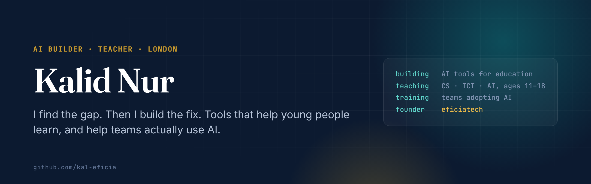

I build AI tools for education and help teams adopt AI properly. I teach Computer Science, ICT and AI to 11 to 18 year olds, run [eficiatech](https://eficiatech.com), and use what I learn in the classroom to build the tools I wish I had.

The mission: **raise a generation of problem solvers who can build and thrive in the AI age.**

### Open-source tools for teachers

| Project | What it does |
|---|---|
| **[pattern-guard](https://github.com/kal-eficia/pattern-guard)** | Finds guessable answer patterns in quizzes (runs, A-B-C-D staircases, alternation) and fixes them. Python CLI, no dependencies |
| **[recall-engine](https://github.com/kal-eficia/recall-engine)** | Spaced-retrieval lesson starters per student, plus six-week progress reviews, from a question bank and an attempts log |
| **[lesson-page-kit](https://github.com/kal-eficia/lesson-page-kit)** | Write a lesson as JSON, get a calm interactive student page with a summary after every page. [Live demo](https://kal-eficia.github.io/lesson-page-kit/) |
| **[mark-point-checker](https://github.com/kal-eficia/mark-point-checker)** | Marks short written answers against exam marking points: "you have got X, still to add Y". No AI model, Python and JavaScript. [Live demo](https://kal-eficia.github.io/mark-point-checker/) |
| **[ai-teaching-skills](https://github.com/kal-eficia/ai-teaching-skills)** | Ten agent skills that make an AI assistant work like an experienced teacher: lesson packs, exam questions, schemes of work, misconceptions, reports |

### For Muslim homes and creators

| Project | What it is |
|---|---|
| **[Tilawah Box](https://github.com/kal-eficia/tilawah-box)** | A screen-free Quran player for the home on a Raspberry Pi: a dial, buttons, NFC cards for children, hifz repeat, Al-Kahf on Fridays |
| **[salah-calendar](https://github.com/kal-eficia/salah-calendar)** | Prayer times as busy blocks in your work calendar, plus a clash checker. Calculated from the sun, no API. [Web app](https://kal-eficia.github.io/salah-calendar/) |
| **[halal-audio-check](https://github.com/kal-eficia/halal-audio-check)** | Finds music in a video's soundtrack, with timestamps, so creators can check before they post |

### For teams adopting AI

| Project | What it is |
|---|---|
| **[ai-skills-kit](https://github.com/kal-eficia/ai-skills-kit)** | Ten agent skills: team AI readiness, workflow-to-agent mapping, AI policy, halal brand fit, hooks, build specs, UI critique, pre-launch security, handover docs |

### Things I've shipped

| Project | What it is |
|---|---|
| **[Lock In](https://github.com/kal-eficia/lock-in)** | A revision game for IGCSE Computer Science and ICT: 914 terms on a motherboard that lights up as you learn and corrupts as you forget. React, TypeScript, offline PWA, Lighthouse 100 accessibility |
| **[Excelia Live](https://github.com/kal-eficia/excelia-live)** | A live class dashboard for remote lessons: every student's answer on the teacher's board within a second. Node, SQLite, Server-Sent Events |
| **[Claude Video Studio](https://github.com/kal-eficia/claude-video-studio)** | A folder you open in Claude Code and talk to like a video editor. Halal sound only |
| **[Tafsir Researcher](https://github.com/kal-eficia/tafsir-researcher)** | Type a concept, see the five most relevant ayat with six classical tafsirs. It surfaces; it never interprets |
| **[EPL xG 2025/26](https://github.com/kal-eficia/epl-xg-2025-26)** | Game-state adjusted xG for the Premier League season |

### How I build

I direct AI agents the way a lead engineer directs a team: a locked spec, a design system, one phase at a time, and a stop gate after every phase that I can see and test. Most of what's here was built that way with **Claude Code** and **Replit** (Level 5 Master Builder). The specs and decision logs are in each repo, so you can see how.

  
  
  
  
  
  
  
  

### Find me

[eficiatech.com](https://eficiatech.com) · [Excelia](https://excelia.eficiatech.com) · [LinkedIn](https://www.linkedin.com/in/kalid-nur-4a37231ab/) · [Instagram @analystkal](https://www.instagram.com/analystkal/) · [X @sonofishmael_](https://x.com/sonofishmael_) · kal@eficiatech.com
